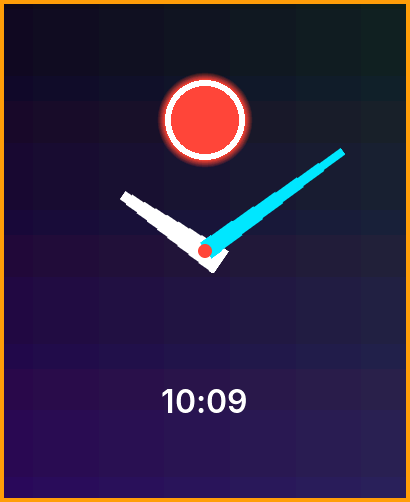

# Images

A face can use pictures: a **background**, **image** elements, and **hand images** (a hand drawn from a picture
instead of a line). Put the PNG files in the face folder and name them in `face.json`.

```json
{
  "background": "bg.png",
  "elements": [
    {"type": "image", "image": "badge.png", "x": 205, "y": 120},
    {"type": "hand", "bind": "time.hour", "x": 205, "y": 251, "image": "hour.png", "pivot": [14, 100]},
    {"type": "hand", "bind": "time.minute", "x": 205, "y": 251, "image": "minute.png"}
  ]
}
```

| Use | How it is drawn |
|---|---|
| `"background": "bg.png"` | At the top left of the screen, at its own size, under everything else. Make it 410 × 502 to cover the screen. The `background` colour shows where the picture is smaller or transparent. Not used in the [always-on layout](aod.md), which is black |
| `image` element | Centred on `(x, y)` at its own size |
| `hand` with `image` | The picture points **up** (12 o'clock). It turns about its `pivot`, a point `[x, y]` in the picture's own pixels, and that point sits on the hand's `(x, y)`. Without `pivot` it turns about the picture's bottom centre. `len`, `tail` and `w` do not apply |



The picture above is the project `docs/projects/face-images` of the SDK repository: a background, an `image` badge, an hour
hand with a `pivot` and a minute hand without one. PNG only (a `.bin` name loads nothing). Any PNG colour type and bit depth works, and **transparency is kept**: a hand
or a badge with soft edges draws over what is behind it.

## Limits

| Limit | Value |
|---|---|
| One file | 256 KB |
| One picture | 1024 pixels on a side, and at most 512 K pixels (a 410 × 502 background is 206 K) |
| All the face's pictures together | 1.5 MB decoded, 3 bytes a pixel. A full-screen background takes 0.6 MB, a 100 × 100 badge 30 KB |
| Package | 1 MB in all |

`s3w face build` checks all of these, and also that every PNG decodes (valid chunks, image data the right size), so a
picture that the watch would refuse is an error on your computer.

## How the watch handles them

The watch decodes a picture once, the first time the face is shown, in the background: the face appears at once and the
picture follows a moment later. Decoded pictures are kept in memory while the face is on the screen (and across the
switch to the always-on layout and back), and are freed when the user changes to another face. A picture that cannot be
loaded is left out: the face is drawn without it, and a hand falls back to a plain line hand.

- Design the face so it reads well without its pictures for that first moment, and keep the `background` colour close to
  the picture's.
- Prefer small pictures: a hand image is a few KB. Photographs make big, slow backgrounds.
- A face that is being made reloads in the simulator whenever you save a picture ([the first face](../start/first-face.md)).

Older firmware ignores pictures: the face shows its vector parts only. Face format `api` stays 1.
