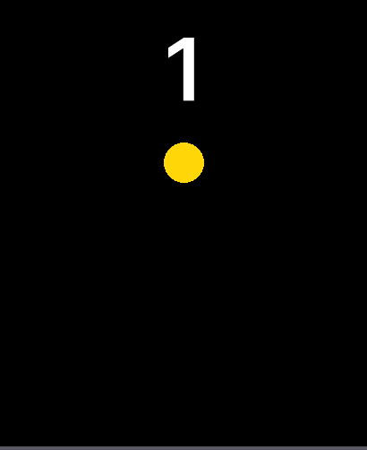
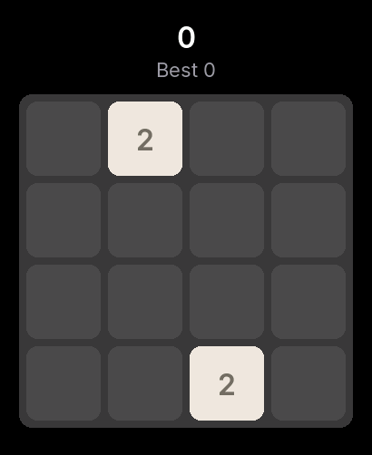
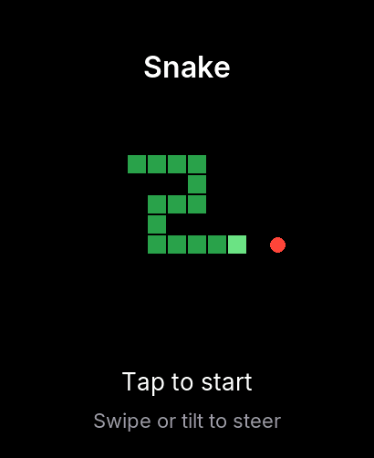
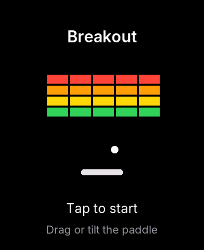
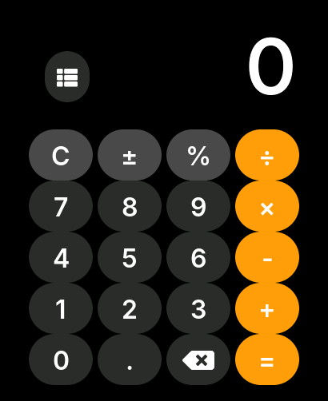
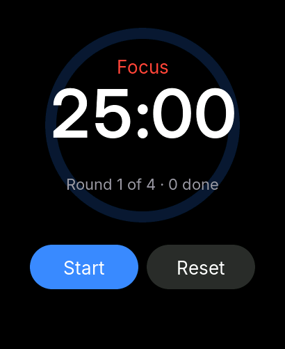

# Samples

The SDK repository's `examples/` folder has small projects to read and copy. Screenshots are taken in the simulator by
scripts, so they are what the code really draws.

## Apps

| | |
|---|---|
|  | **Counter** (widgets). What `s3w new` gives you: a label, a button, a value kept in storage. [First app (C)](../start/first-app-c.md) |
|  | **Bounce** (canvas). A frame loop, tap input and a high score. [First game](../start/first-game.md). The project is `docs/projects/first-game` |
|  | **2048** (canvas). Swipe input, a saved board. `examples/apps/2048` |
|  | **Snake** (canvas). Swipe or tilt control, sound. `examples/apps/snake` |
|  | **Breakout** (canvas). Drag or tilt a paddle, sprites. `examples/apps/breakout` |
|  | **Calculator** (widgets). A keypad of buttons, a history list. `examples/apps/calculator` |
|  | **Pomodoro** (widgets). Timers, a progress ring, notifications. `examples/apps/pomodoro` |

The others in `examples/` are single-file programs for the API: `widgets` (a tour of the widgets), `bench` (a canvas
benchmark with 48 sprites) and `iodemo` (tilt, touch, HTTP and notifications).

## Faces

| | |
|---|---|
|  | **Sunset**. Big time, the date, a steps ring and a complication. [First face](../start/first-face.md). The project is `docs/projects/first-face` |
