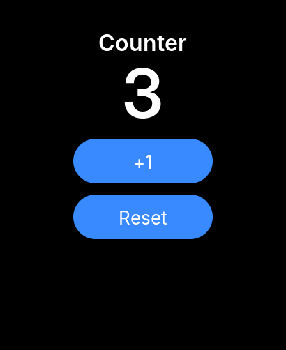

# Your first app (C)

An app is a folder with a `manifest.json` and some source. `s3w new` makes one from a template: a counter that keeps
its value when the app is closed.

```bash
s3w new counter --id dev.you.counter --name "Counter"
s3w run-sim counter
```

The simulator opens with the app running. Edit `counter/src/main.c` and save: the CLI rebuilds and the simulator
restarts the app, keeping its stored data. A failed build prints the compiler's error and leaves the last good
build running. Press Ctrl-C to stop.



## The code

The whole app is one file. It is freestanding C: no libc, only `s3w.h`.

```c-check template=c
/*
 * Counter: a counter that survives restarts (the S3Wear C template, api_level 1).
 *
 *   s3w build .     -> build/app.wasm and build/dev.you.counter.s3app
 *   s3w run-sim .   -> the simulator, rebuilt and reloaded on every save
 *
 * Freestanding C: no libc (s3w.h is the whole API). Callbacks must return within
 * 250 ms. The developer docs have the API and the rules.
 */
#include "s3w.h"

#define STR(s) s, (int)(sizeof(s) - 1)

static int s_count_label, s_plus, s_reset;
static int s_count;

/* n in decimal into buf (at least 12 bytes); returns the length. */
static int fmt_int(char *buf, int n)
{
    char d[12];
    int k = 0, len = 0;
    unsigned u = n < 0 ? (unsigned)-n : (unsigned)n;
    do {
        d[k++] = (char)('0' + u % 10);
        u /= 10;
    } while (u);
    if (n < 0) {
        buf[len++] = '-';
    }
    while (k) {
        buf[len++] = d[--k];
    }
    return len;
}

static void show(void)
{
    char t[12];
    s3w_ui_set_text(s_count_label, t, fmt_int(t, s_count));
}

static void save(void)
{
    s3w_kv_set(STR("count"), &s_count, sizeof s_count); /* app-private storage */
}

void s3w_on_start(void)
{
    s3w_log(S3W_LOG_INFO, STR("Counter started"));
    if (s3w_kv_get(STR("count"), &s_count, sizeof s_count) != (int)sizeof s_count) {
        s_count = 0;
    }
    const int scr = s3w_ui_screen();
    s3w_ui_set_style(scr, S3W_STYLE_FLEX, S3W_FLEX_COLUMN);
    s3w_ui_set_style(scr, S3W_STYLE_PAD, 40);
    s3w_ui_set_style(scr, S3W_STYLE_GAP, 16);

    const int title = s3w_ui_label(scr, STR("Counter"));
    s3w_ui_set_style(title, S3W_STYLE_FONT, S3W_FONT_TITLE);
    s_count_label = s3w_ui_label(scr, STR("0"));
    s3w_ui_set_style(s_count_label, S3W_STYLE_FONT, S3W_FONT_DISPLAY);
    s_plus = s3w_ui_button(scr, STR("+1"));
    s3w_ui_set_size(s_plus, 200, S3W_SIZE_CONTENT);
    s_reset = s3w_ui_button(scr, STR("Reset"));
    s3w_ui_set_size(s_reset, 200, S3W_SIZE_CONTENT);
    show();
}

void s3w_on_event(const s3w_event_t *e)
{
    if (e->type != S3W_EV_CLICK) {
        return;
    }
    if (e->handle == s_plus) {
        s_count++;
    } else if (e->handle == s_reset) {
        s_count = 0;
    }
    show();
    save();
}
```

What each part does:

- `s3w_on_start` is called once when the app opens. It reads the saved count with [`s3w_kv_get`](../api/storage.md#s3w_kv_get)
  and builds the screen: a column of a label and a button.
- Widgets are **handles**: small integers the watch gives you (`s3w_ui_label` returns one). You pass a handle back to
  change the widget. They are never pointers.
- `s3w_on_event` receives input. A tap on a button arrives as `S3W_EV_CLICK` with the button's handle; the code compares it with the handles it saved.
- Strings are `(pointer, length)` pairs. The `STR("...")` macro makes both from a literal.
- `s3w_kv_set` saves the count in the app's private storage, so it survives restarts.

## The manifest

`manifest.json` names the app and says what it needs:

```manifest-check
{
  "id": "dev.you.counter",
  "name": "Counter",
  "version": "0.1.0",
  "api_level": 1,
  "category": "app",
  "entry": "app.wasm",
  "ui_mode": "widgets",
  "memory_kb": 64,
  "permissions": []
}
```

The `id` is reverse-DNS and must be unique. `ui_mode` is `widgets` (buttons, labels, lists) or `canvas` (you draw
every pixel: games). [The manifest reference](../reference/manifest.md) lists every key.

## On the watch

```bash
s3w keygen                                    # once: ~/.s3w/dev.key signs your packages
s3w install counter --usb --trust-key         # first time: the watch trusts your key
s3w install counter --usb                     # later: tap Install on the watch
s3w logs                                      # your app's s3w_log lines
```

The app appears in the launcher under Mini apps. A long press uninstalls it. See [packages and signing](../concepts/packages-and-signing.md)
for what `--trust-key` does.

## Next

[Your first game](first-game.md) draws on a canvas. [Concepts](../concepts/lifecycle.md) explains the rules.
