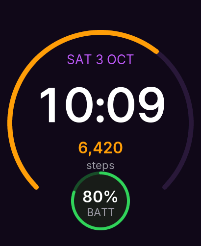

# Your first watch face

A watch face is data, not code. A `face.json` lists elements (text, arcs, hands, shapes) placed on the screen, and
each one **binds** to a value the watch already has: the time, the date, steps, battery. You cannot run code in a
face, so faces are safe to install without asking for permissions.

Start from the template, or make a folder with one file:

```bash
s3w new --face sunset --id dev.you.sunset --name "Sunset"     # a working face in sunset/face.json
s3w face run-sim sunset                                       # the simulator; every save reloads it
```

The file, in full:

```face-check project=first-face
{
  "id": "dev.you.sunset",
  "name": "Sunset",
  "version": "1.0.0",
  "api": 1,
  "author": "You",
  "description": "Big time, the date and a steps ring.",
  "background": "#120A1F",
  "elements": [
    {"type": "arc", "bind": "steps.goal_ratio", "x": 205, "y": 251, "r": 190, "w": 10,
     "start": 135, "end": 405, "color": "#FF9F0A", "track": "#2A1A3D"},
    {"type": "text", "bind": "date.EEE d MMM", "x": 205, "y": 120, "font": "body_26",
     "color": "#BF5AF2", "upper": true},
    {"type": "text", "bind": "time.hh:mm", "x": 205, "y": 220, "font": "digits_96", "color": "#FFFFFF"},
    {"type": "text", "bind": "steps.count", "x": 205, "y": 300, "font": "title_32", "color": "#FF9F0A"},
    {"type": "text", "text": "steps", "x": 205, "y": 336, "font": "caption_22", "color": "#9A9AA0"},
    {"type": "complication", "slot": "bottom", "x": 205, "y": 410, "style": "circle", "default": "battery"}
  ],
  "aod": {
    "elements": [
      {"type": "text", "bind": "time.hh:mm", "x": 205, "y": 251, "font": "digits_96_light", "color": "#6E6E73"}
    ]
  }
}
```

`s3w face run-sim sunset` opens the simulator with the face and **reloads it every time you save** `face.json` or a picture
(a mistake is printed with its line and column, and the window keeps the last good face). Click the window and press
keys to try the face with other data: **B** a low battery, **P** no phone (no weather, no next event), **H** a 12-hour
clock, **A** the always-on layout, **N** no data at all, **R** back to normal. The same states are in scripts as
`demo low-battery on` and the like ([simulator scripts](../reference/simulator-scripts.md)).

Build the package when you are happy:

```bash
s3w face build sunset                              # checks face.json, renders sunset/build/preview.png, packs and signs
s3w face verify sunset/build/dev.you.sunset.s3face
s3w face run-sim sunset --screenshot sunset.png    # a full-size picture, headless
```



The simulator shows a pinned time (10:09) and demo data, so a picture is the same every run.

## What the file says

- `id`, `name`, `version`, `api`: the identity. The `id` is lower case letters, digits, `.`, `_` and `-`. Another face
  with the same id is an update, if its `version` is not older.
- `background`: a colour. The screen is 410 × 502; every element is placed by its centre `(x, y)`.
- `elements`: up to 32, drawn in order. `arc` shows how far a value (here `steps.goal_ratio`, 0 to 1000) has come
  around a ring; `text` shows a binding or fixed text in one of six fonts.
- `complication`: a slot the user can fill with another piece of information (battery, weather, next event); `default`
  is what it shows until they change it. A tap on it opens the matching app.
- `aod`: what to draw when the display is in its always-on low-power mode (black, few pixels lit).

## On the watch

`s3w face build` makes `build/<id>.s3face`, signed with your developer key like an app (`s3w keygen`; the watch must
trust the key, see [packages and signing](../concepts/packages-and-signing.md)). Put the file on the watch's SD card and
run `face install <file>` on the watch's USB console. Installing faces straight from the CLI is planned; the simulator
is the quick loop until then. Pictures work too: see [images](../faces/images.md). The
[faces section](../faces/overview.md) covers every element, binding and limit.
